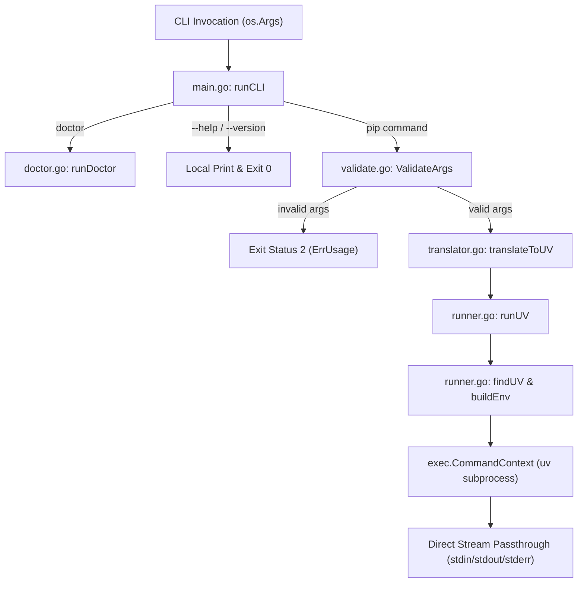

# uvpip

[](https://pypi.org/project/uvpip-cli/)
[](https://github.com/yv3000/uvpip/actions/workflows/ci.yml)
[](https://github.com/yv3000/uvpip/actions)
[](LICENSE)

Type `pip`, run [uv](https://github.com/astral-sh/uv).

uvpip is a small Go wrapper that translates common pip commands to uv. Optional
per-user `pip` and `pip3` shims and shell functions let you keep familiar commands
without replacing Python's pip installation. Speed and compatibility depend on
uv, your packages, network, and environment; uvpip is not a complete pip emulator.

**Project type:** standalone command-line tool and per-user installer. It is not
a backend service: no network listeners, no daemon, no persistent state, and no
database. Each invocation runs uv once and exits with uv's status.

> **Releases:** Tagged releases with multi-platform binary assets and SHA-256
> checksum manifests are published at [releases](https://github.com/yv3000/uvpip/releases).
> Running an installer without a local binary downloads the latest published
> release asset. Use the local-build route below to compile directly from source.

## Installation

### Via PyPI
```bash
pip install uvpip-cli
```

### Via Pre-compiled Native Binaries
Download native pre-compiled executables for Windows, macOS, and Linux on amd64/arm64 from [GitHub Releases](https://github.com/yv3000/uvpip/releases).

## Requirements

- A working [uv installation](https://docs.astral.sh/uv/getting-started/installation/)
  and a Python interpreter supported by that version of uv.
- For source builds and project verification: Go **1.26.8** (module language
  minimum **1.26.0**). No third-party Go runtime dependencies are required.
- Installers target Windows, macOS, and Linux on amd64 and arm64. CI runs the Go
  test suite and offline installer tests natively on Ubuntu 24.04, macOS 14, and
  Windows Server 2022; Git Bash tests are not native Linux/macOS execution.
- Windows installation uses PowerShell. Windows installer tests explicitly use
  Windows PowerShell **5.1**. POSIX installation uses `sh` and standard utilities;
  downloading requires `curl` or `wget`.

uvpip itself does not install Python. The explicit installer can install uv if
it is absent; the revised runtime never downloads or installs anything on its own.
Package operations delegated to uv can, of course, access the network and modify
the selected Python environment.

## Build And Test From A Fresh Clone

Only Git and Go 1.26 (verification pins 1.26.8) are needed; nothing else must be
installed first.

```sh
git clone https://github.com/yv3000/uvpip.git
cd uvpip
go mod verify            # checks downloaded modules against go.sum hashes
go build ./...           # writes the uvpip binary into the checkout (gitignored)
go test ./...            # full unit + subprocess-fixture suite, offline
```

The same commands, plus `go vet`, a 90% coverage gate, `golangci-lint`,
`govulncheck`, ShellCheck, and installer tests, run on every push and pull
request in [CI](.github/workflows/ci.yml). Tests never touch your real profile,
PATH, pip, or uv. `go.sum` exists only because development tools (`govulncheck`, `actionlint`) are
pinned with Go `tool` directives in `go.mod`; they are dev-only and never linked
into the uvpip binary. Automated weekly dependency updates for tools and Actions
are managed via [.github/dependabot.yml](.github/dependabot.yml). See
[CONTRIBUTING.md](CONTRIBUTING.md) for the full verifier.

### Dependency Policy

uvpip enforces a strict **zero third-party runtime dependencies** guarantee. All core CLI routing, translation, validation, subprocess execution, and logging rely exclusively on the Go standard library. Build, linting, and vulnerability audit utilities (`actionlint`, `govulncheck`, `pip-audit`) are pinned with exact versions and checksums, and are strictly excluded from the compiled binary. Automated weekly dependency updates for tools, Python packages, and GitHub Actions are continuously maintained via [.github/dependabot.yml](.github/dependabot.yml).

To independently verify that no third-party libraries are linked into the binary:

```sh
# Confirms zero third-party runtime packages; prints nothing when clean
go list -deps -f '{{if and (not .Standard) (not .Module.Main)}}{{.ImportPath}}{{end}}' ./...
```

This guarantee is enforced on every push in [CI](.github/workflows/ci.yml) via the `Verify zero runtime deps` step on all three operating systems. Dual-stack vulnerability scanning runs on every push: Go dependencies are scanned via `govulncheck`, and Python packaging dependencies are audited via pinned `pip-audit`. Each test job retains `coverage.out` and the per-function `coverage.txt` summary in its OS-specific artifact for 14 days. The live README coverage badge is automatically synchronized from `coverage.txt` via `scripts/update-coverage-badge.sh`.

## Install From Source

Review a checkout before executing its scripts. Build with Go 1.26.8 from the
repository root, and choose an output path outside the checkout. Do not overwrite
an existing local binary. Install uv separately first if you want to avoid the
installer downloading and executing the official uv setup script.

### Windows

In a normal PowerShell session, with `$buildDir` set to an existing directory
reserved for build output:

```powershell
$binary = Join-Path $buildDir 'uvpip-source.exe'
go build -o $binary ./...
if ($LASTEXITCODE -ne 0) { throw 'Build failed' }
$hash = (Get-FileHash -LiteralPath $binary -Algorithm SHA256).Hash
& .\installer\install.ps1 -BinaryPath $binary -SHA256 $hash
```

This installs into `$env:USERPROFILE\.uvpip\bin`, adds `pip.cmd`/`pip3.cmd`,
adds functions to the current PowerShell host's `$PROFILE`, and updates **User
PATH**. It never elevates or edits **System PATH**. Different PowerShell hosts
can have different profiles. Use `-NoProfile` and/or `-NoPath` to opt out of the
corresponding integration. `UVPIP_BINARY` and `UVPIP_SHA256` supply defaults for
`-BinaryPath` and `-SHA256`.

### macOS / Linux

With `BUILD_DIR` set to an existing directory reserved for build output:

```sh
go build -o "$BUILD_DIR/uvpip-source" ./... &&
UVPIP_BINARY="$BUILD_DIR/uvpip-source" sh installer/install.sh
```

This installs into `$HOME/.uvpip/bin`. Based on `$SHELL`, it adds a marked block
to bash, zsh, fish, or `.profile` configuration. The block sets PATH and defines
`pip`/`pip3` functions. Set `UVPIP_NO_PROFILE=1` to skip profile integration and
manage PATH yourself. Set `UVPIP_SHA256` to an independently checked SHA-256
digest to validate a new candidate binary before execution.

### Installation Notes

- Restart your terminal after install or uninstall. Existing sessions can retain
  functions or cached command locations. No blanket promise of shell interception
  applies to hosts that do not load the modified profile.
- Installers check a candidate's `--version`, use private staging directories,
  and can validate a caller-supplied checksum. They do **not** authenticate release
  signatures. Hashing a local build detects a changed copy, not malicious source.
- Without a local binary, installers download the platform asset from
  `releases/latest/download`. That URL is mutable. Review the exact release and
  obtain a trusted checksum, or build reviewed source yourself. See
  [SECURITY.md](SECURITY.md#threat-model-installer-scripts-and-trust-boundaries)
  for the installer threat model and trust boundaries.
- If uv is absent from command lookup, explicit installation downloads its
  official installer fully before executing it. A local uvpip binary alone does
  not make installation offline; uv must already be available.
- Re-running installation preserves an existing uvpip executable. It is not an
  automatic upgrade and a supplied checksum is not rechecked against an existing
  install. To change versions, preserve anything you need, uninstall, then install
  the reviewed replacement.
- Development environment helpers redirect HOME, caches, and temporary paths.
  **Do not source `scripts/env.ps1` in a live installation session.** Use a fresh
  normal shell for a real install, or deliberately use a sandbox for testing.

### Offline Installer Verification

To test and verify the installers in air-gapped or offline environments without network access, use the standalone test runner scripts:

**PowerShell (Windows)**:
```powershell
& .\scripts\test-installers.ps1 -TestRoot $env:TEMP\uvpip-tests -CacheRoot $env:TEMP\uvpip-cache
```

**POSIX sh (Linux / macOS)**:
```sh
sh ./scripts/test-installers.sh /tmp/uvpip-tests /tmp/uvpip-cache
```

These scripts verify candidate binaries, validate version outputs, test clean uninstallation, and assert staging directory isolation without attempting external network requests.

## Usage

```sh
uvpip --version
uvpip install requests
uvpip install -r requirements.txt
uvpip uninstall requests
uvpip list
uvpip freeze
uvpip doctor
```

After shell integration, substitute `pip` or `pip3` for `uvpip`.

### Command Translation

- Most arguments are forwarded as `uv pip <arguments>`, including `install`,
  `list`, `show`, `freeze`, and `check`.
- `uninstall` and the `remove` alias become `uv pip uninstall`. `-y` and `--yes`
  are stripped before `--` because uv does not use pip's confirmation prompt.
  Arguments after `--` are preserved.
- `upgrade <arguments>` is a uvpip convenience alias for
  `uv pip install --upgrade <arguments>`, not a standard pip command.
- `cache <arguments>` becomes `uv cache <arguments>`. Forwarding `cache list`
  does not guarantee your uv version implements it.
- No arguments, leading `--help`/`-h`, leading `--version`/`-V`, and `doctor` are
  handled locally. `-v` is forwarded to uv, not treated as wrapper version.
- Unknown commands and flags go to uv. Unsupported operations fail with uv's
  error; uvpip never retries with real pip. See uv's
  [pip compatibility documentation](https://docs.astral.sh/uv/pip/compatibility/).

The child process receives argument boundaries directly, without a runtime shell,
and inherits stdin, stdout, and stderr without output rewriting. A normal uv exit
code is returned unchanged. A blank pip command (for example `pip ""`) is
rejected with **2** before uv starts. Failure to locate uv returns **127**;
failure to start the resolved executable returns **126**. Signal termination has
no portable child exit code and returns **1**.

Interrupt cancellation terminates the direct uv child; it does not guarantee
termination of every descendant. When streams require Go-managed copying, pipe
draining is bounded to one second after child exit or cancellation. If uv exits
successfully but a descendant retains its output pipes beyond that bound, uvpip
reports the incomplete output and returns **1**. This is not a runtime limit on
package installation and does not bound arbitrary blocking caller-supplied I/O.

### Architecture

`uvpip` is architected as a lean, self-contained CLI wrapper built entirely upon the Go standard library, with **zero external runtime dependencies**. The codebase comprises 21 focused Go files (7 core implementation modules and 14 dedicated verification test suites):

#### Module Responsibilities

| Module | Responsibility |
|---|---|
| [`main.go`](main.go) | CLI entry point (`main`, `runCLI`); handles native flags (`--version`, `--help`, `doctor`), initializes structured logging, invokes boundary validation, routes translation, and delegates to the process runner. |
| [`translator.go`](translator.go) | Argument mapping engine; maps pip subcommands/flags to `uv pip`, validates bundled verbosity flags (`-v`, `-q`), strips confirmation flags (`-y`), and preserves literal arguments after `--`. |
| [`validate.go`](validate.go) | Input schema validation; enforces boundary limits (`MaxArgCount = 512`, `MaxArgLen = 4096`), blocks embedded null bytes, rejects blank commands, and inspects `UVPIP_UV` override paths. |
| [`runner.go`](runner.go) | Subprocess supervisor; discovers uv executable path (`findUV`), prepares clean child environments (`buildEnv`), connects I/O streams directly, handles process signals, and bounds pipe draining (`cmd.WaitDelay`). |
| [`doctor.go`](doctor.go) | Environment diagnostics; verifies PATH resolution for `uv`, `pip`, `pip3`, and `python`, validates installed text shims (`isUvpipShim`), and probes tool versions with timeouts. |
| [`logging.go`](logging.go) | Structured telemetry; initializes `slog.Logger` with `component=uvpip`, supports opt-in diagnostics via `UVPIP_DEBUG`, and protects against credential leakage in logs. |
| [`errors.go`](errors.go) | Sentinel error taxonomy; defines standardized domain errors (`ErrInvalidArgs`, `ErrUsage`, `ErrNotShim`, `ErrFlagConflict`, `ErrArgBounds`, `ErrUVNotFound`, `ErrCannotExecute`, `ErrRecursiveExecution`). |

#### Logging Architecture

Structured telemetry throughout `uvpip` is implemented using Go's standard library `log/slog` framework. All entry points (`main.go`, `runner.go`, `doctor.go`, `validate.go`) initialize or consume `*slog.Logger` with `component=uvpip`. By default, logging operates at `slog.LevelInfo` to record critical execution failures to `stderr` without polluting standard CLI output. When `UVPIP_DEBUG=1` is provided, the handler switches to `slog.LevelDebug` for full process telemetry. All sensitive parameters (package URLs with basic auth, token headers, user arguments) are strictly redacted to prevent credential exposure.

#### Verification Test Suites (14 Specs)

| Test Suite | Coverage Domain |
|---|---|
| [`main_test.go`](main_test.go) | CLI entry point dispatch, version reporting, and usage flag routing. |
| [`runner_exec_test.go`](runner_exec_test.go) | Subprocess execution, exit code mapping, and offline parity assertions. |
| [`runner_env_test.go`](runner_env_test.go) | Candidate resolution, environment construction, and recursion protection. |
| [`runner_lifecycle_test.go`](runner_lifecycle_test.go) | Process lifecycle, child interrupt cancellation, and inherited output pipe drain timeouts. |
| [`translator_test.go`](translator_test.go) | Command translation rules, flag stripping, bundled verbosity, and option arguments. |
| [`validate_test.go`](validate_test.go) | Input boundary validation and conflicting verbosity flag detection. |
| [`validate_schema_test.go`](validate_schema_test.go) | Table-driven argument boundary schemas, length caps, and null-byte injection. |
| [`doctor_test.go`](doctor_test.go) | Health check diagnostics, executable resolution, and shim identification. |
| [`logging_test.go`](logging_test.go) | Structured logging levels, key-value attributes, and sensitive token redaction. |
| [`errors_test.go`](errors_test.go) | Sentinel error taxonomy assertions and `errors.Is`/`As` hierarchy unwrapping. |
| [`integration_test.go`](integration_test.go) | End-to-end command execution, stream pass-through, and mock uv interactions. |
| [`windows_test.go`](windows_test.go) | Windows-specific `.cmd` shim parsing, case-insensitive PATH lookup, and stream redirection. |
| [`fuzz_test.go`](fuzz_test.go) | Continuous fuzzing campaigns for argument boundaries, translation invariants, and overrides. |
| [`benchmark_test.go`](benchmark_test.go) | Go benchmark suites asserting sub-microsecond translation, 0-allocation boundary validation, and candidate path resolution. |

#### Execution Flow



### Performance & Speed Comparison

`uvpip` adds near-zero wrapper overhead while granting full access to `uv`'s native Rust execution speed. 

#### Go Microbenchmarks (`go test -bench=. -benchmem`)

| Benchmark Target | Latency | Heap Allocation | Alloc Count | Throughput |
|---|---|---|---|---|
| `BenchmarkTranslateToUV` | **154 ns/op** | 56 B/op | 2 allocs/op | >6.4M ops/sec |
| `BenchmarkValidateArgs` | **87 ns/op** | **0 B/op** | **0 allocs/op** | >11.4M ops/sec |
| `BenchmarkCanonicalValidationSchema` | **219 ns/op** | **0 B/op** | **0 allocs/op** | >4.5M ops/sec |
| `BenchmarkUVCandidatePaths` | **8.0 µs/op** | 1,120 B/op | 20 allocs/op | >125K ops/sec |

#### End-to-End Speed vs Standard Python `pip`

Real-world execution comparison measured on Windows:

| Operation | Standard `pip` | Accelerated `uvpip` | Speed Difference |
|---|---|---|---|
| **CLI Dispatch / Version Check** | `999.8 ms` | `21.0 ms` | **47.6x faster** |
| **Package Listing (`pip list`)** | `7,069.9 ms` | `153.2 ms` | **46.2x faster** |
| **Dependency Resolution (`install --dry-run`)** | `4,984.3 ms` | `204.4 ms` | **24.4x faster** |

Wrapper latency over raw `uv` is negligible (<1ms), ensuring that script startup times and automated build pipelines suffer zero penalty.

### Observability, Health & Telemetry

#### Structured Logging via `log/slog`

`uvpip` standardizes on Go's standard library `log/slog` engine for structured, contextual telemetry. Logging is gated by the `UVPIP_DEBUG` environment variable (`UVPIP_DEBUG=1` or `UVPIP_DEBUG=true`). In standard operation, logging operates at `slog.LevelInfo` so that critical execution errors are recorded without emitting noisy diagnostics. When `UVPIP_DEBUG` is active, it automatically transitions to `slog.LevelDebug` with key-value diagnostics.

**Security & Redaction Invariant**: As defined and asserted by [`logging_test.go`](logging_test.go), all telemetry strictly redacts user argument values, index URLs, and environment variables to ensure bearer credentials and auth tokens are never logged.

#### Health Probes (`uvpip --health`)

For automated environments, health checkers, and deployment scripts, `uvpip --health` executes diagnostic checks across the resolved `uv` binary, PATH shims, and Python interpreter, outputting machine-readable JSON:

```bash
uvpip --health
```

```json
{
  "status": "ok",
  "healthy": true,
  "timestamp": "2026-10-22T04:15:00Z",
  "probes": [
    {"component": "uv", "status": "healthy", "details": "C:\\Users\\...\\uv.exe"},
    {"component": "pip", "status": "healthy", "details": "..."},
    {"component": "pip3", "status": "healthy", "details": "..."},
    {"component": "python", "status": "healthy", "details": "..."}
  ]
}
```

Exits `0` if all components are healthy, or `1` if degraded.

#### Runtime Metrics & Telemetry (`uvpip --metrics`)

`uvpip --metrics` outputs execution telemetry, goroutine counts, and Go runtime memory statistics (`runtime.MemStats`) formatted as JSON:

```bash
uvpip --metrics
```

### Environment Selection

uvpip preserves the user environment, including explicit `UV_SYSTEM_PYTHON`.
When neither `VIRTUAL_ENV` nor `CONDA_PREFIX` is nonempty and there is no
`UV_SYSTEM_PYTHON` entry, it defaults `UV_SYSTEM_PYTHON=1`. Activated virtual and
Conda environments therefore follow uv's selection unless explicitly overridden.
uvpip does not translate `PIP_PYTHON` into a uv interpreter override. Use
uv-supported interpreter options when exact selection matters.

`UVPIP_UV` optionally selects an **absolute** executable path. Otherwise uvpip
searches PATH, then known per-user/platform installation locations. It refuses
Go's `ErrDot` current-directory lookup and excludes relative fallback candidates.
It rejects uv resolving to its own executable using `os.SameFile`, including
hardlinks or symlinks to that same file, but not separate identical copies.
An invalid explicit override fails rather than falling back to a different uv;
blank values and values with leading or trailing whitespace (usually a quoting
mistake) are reported as such.
Only point the override and PATH at trusted executables.

### Input Validation

Before translating or launching pip commands, `runCLI` calls `ValidateArgs` to enforce these boundaries:

- **Locally rejected (exit status 2)**: Blank commands, more than 512 arguments, arguments longer than 4,096 bytes, embedded null bytes, and conflicting `--quiet` (`-q`) and `--verbose` (`-v`) flags. Verbosity checking stops at `--`; subsequent arguments are literal operands. With no arguments, uvpip still prints help and exits successfully.
- **Forwarded to uv**: Package names, valid options, standard pip flags, and index URLs within these boundaries. uv determines their meaning, selects the interpreter for `--python`, and may reject unsupported options.
- **Path override constraints**: `UVPIP_UV` must be a clean, unpadded, absolute path; relative paths or whitespace-padded values fail discovery with exit code **127** (`ErrInvalidOverride`).
Argument contents are never echoed by uvpip's diagnostics. Executable paths can appear in discovery and launch errors; redact local paths before sharing logs.

Shell functions can keep intercepting `pip` after virtual environment activation
when the profile was loaded. Noninteractive processes, aliases, other profiles,
and venv PATH precedence can bypass them. Call `uvpip` explicitly in automation.
To deliberately bypass the wrapper, use the desired interpreter's pip:

```sh
python -m pip install requests
```

### Diagnostics

`uvpip doctor` checks uv, pip, pip3, and Python (with `python3` fallback), recognizes
the shipped text shims, and returns **1** on a failed check. uv/Python version
probes have a five-second timeout. This is an executable/PATH check, not proof
that a parent shell function or alias is active; a working interactive function
can coexist with a failed PATH-shim check. Inspect `Get-Command pip -All` in
PowerShell or `type pip` in your interactive POSIX shell when investigating that.

For a single command, set `UVPIP_DEBUG=1` to print structured `key=value`
records to stderr showing which uv was resolved and how, whether
`UV_SYSTEM_PYTHON=1` was defaulted, and uv's exit code and duration. Argument
values and environment contents are never logged, so index credentials in
URLs stay out of the output. With the variable unset, uv's stderr is untouched.

#### Troubleshooting Debug Output

Use the debug variable for one invocation so that normal command output stays
unchanged. In POSIX shells:

```sh
UVPIP_DEBUG=1 uvpip install requests
```

In PowerShell:

```powershell
$env:UVPIP_DEBUG = '1'
uvpip install requests
Remove-Item Env:UVPIP_DEBUG
```

For a command forwarded to uv, read the records in this order:

| Record | Meaning | Next check |
| --- | --- | --- |
| `msg="translated command"` | uvpip accepted the input and routed it to uv; `arg_count` is logged instead of argument values. | If this is missing, inspect the validation error printed by uvpip. |
| `msg="resolved uv"` | The executable was found. `source=UVPIP_UV` means the absolute override was used; `source=search` means PATH or a known per-user/platform location was used. | Confirm that `path` points to the intended uv installation. |
| `msg="prepared environment"` | `default_uv_system_python=true` means uvpip added `UV_SYSTEM_PYTHON=1`; `false` means an activated environment or an explicit setting was preserved. | Check `VIRTUAL_ENV`, `CONDA_PREFIX`, or `UV_SYSTEM_PYTHON` if uv selects the wrong interpreter. |
| `msg="uv exited"` | uv started and returned the logged `code`; `duration` is the elapsed execution time. | Use uv's stderr for the package or resolver error. |

If discovery fails, the record is `msg="uv discovery failed"` and the command
also prints an install link. Check that `uv --version` works, or set
`UVPIP_UV` to an existing absolute uv executable. A malformed, relative, or
whitespace-padded override is rejected instead of falling back to another
binary. If uv was found but could not be started, look for
`msg="uv execution failed"` and verify that the file is executable and matches
the current platform.

`uvpip doctor` uses the same logger but prints its human-readable checks to
stdout. It checks `uv`, `pip`, `pip3`, and `python` (falling back to
`python3`). An `[OK]` line means the executable or shipped uvpip shim was
recognized; `[!!]` identifies the target that needs attention. A failed version
probe can mean that the executable was found but did not start or did not
respond within the five-second probe timeout. The command exits with `1` when
any check fails.

The doctor checks PATH executables, not aliases or shell functions in the
parent shell. If it reports a shim problem, inspect command precedence with
`Get-Command pip -All` in PowerShell or `type -a pip` in a POSIX shell. If the
interactive shell uses a function but PATH does not contain the shim, call
`uvpip` explicitly or restart the shell after installation. When sharing debug
output, redact local filesystem paths even though argument values and
environment contents are intentionally omitted.

### Observability

uvpip is a stateless, short-lived command-line wrapper rather than a long-running service or daemon. Consequently, continuous background health listeners, Prometheus metrics scrapers, and network observability endpoints do not exist. Instead, observability is tailored to the CLI execution lifecycle:
- **On-demand diagnostic health:** [`uvpip doctor`](#diagnostics) validates local PATH shims, uv binary discovery, and Python runtime availability.
- **Structured execution audit logging:** Setting [`UVPIP_DEBUG=1`](#environment-variables) emits structured key-value diagnostics (`log/slog`) to standard error tracking command translation, environment configuration, process exit codes, and execution latency without logging credential-bearing arguments. Critical execution failures (such as missing uv executables) emit structured Info audit records to stderr even when debug mode is disabled.

### Environment Variables

All variables are optional. [.env.example](.env.example) documents each one;
it is a reference template, and uvpip never loads `.env` files.

| Variable | Read by | Purpose |
| --- | --- | --- |
| `UVPIP_UV` | runtime | Absolute path to the uv executable (see Environment Selection). |
| `UVPIP_DEBUG` | runtime | `1`/`true`/`yes`/`on` enables stderr diagnostics. |
| `UV_SYSTEM_PYTHON` | uv | Passed through; defaulted to `1` outside venv/Conda. |
| `HOME`, `USERPROFILE`, `APPDATA`, `LOCALAPPDATA` | runtime | OS-provided; locate fallback uv install directories. |
| `UVPIP_BINARY` | installers | Local binary to install instead of downloading. |
| `UVPIP_SHA256` | installers | Expected SHA-256 of the binary being installed. |
| `UVPIP_NO_PROFILE` | POSIX installer/uninstaller | `1` skips the shell profile block. |

## Uninstall

Run the reviewed script from the same checkout in a normal shell:

```powershell
& .\uninstaller\uninstall.ps1
```

```sh
sh uninstaller/uninstall.sh
```

Uninstall removes known uvpip binaries/shims and complete, exactly marked profile
blocks, while retaining unrelated files. Windows removes matching User PATH
entries, not System PATH. Legacy System PATH entries require manual review.
Malformed profile markers cause failure rather than guessed deletion; repair
them manually and retry. Windows accepts `-NoProfile`/`-NoPath`; POSIX accepts
`UVPIP_NO_PROFILE=1`. Python's pip and uv are not uninstalled. Restart the shell.

## Development And Security

See [ARCHITECTURE.md](ARCHITECTURE.md) for the request flow and the role of
each file, and [CONTRIBUTING.md](CONTRIBUTING.md) for required fresh-clone verification,
formatting/tests, pinned tools, the coverage gate, and the release workflow checklist.
The CI workflow does not publish binaries. The separate [Release workflow](.github/workflows/release.yml)
publishes on version-tag pushes or manual dispatch; maintainers must verify the
source and green native CI before triggering it.

See [SECURITY.md](SECURITY.md) for the trust model and reporting guidance, and
[CHANGELOG.md](CHANGELOG.md) for released versus unreleased changes.

## License

[MIT](LICENSE), copyright (c) 2026 YV.
